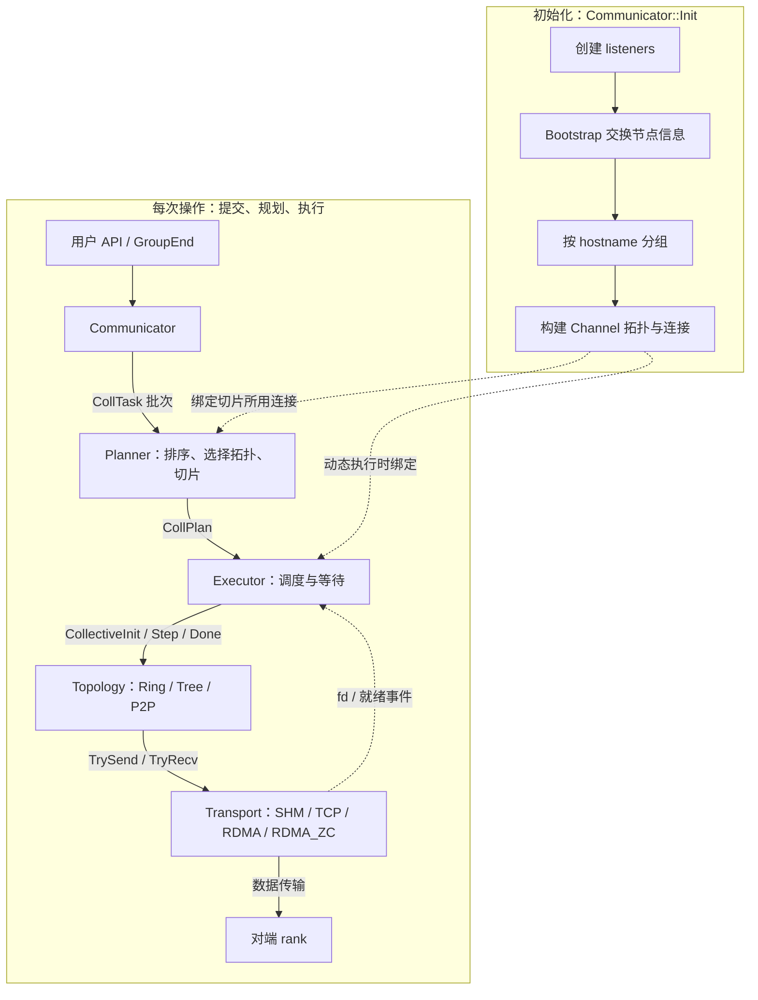
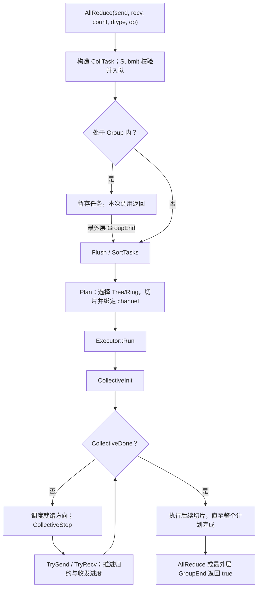

# OriginCCL

OriginCCL 是一个受 NCCL 启发的 **C++ 集合通信（collective communication）库**，面向多进程分布式训练场景。

## 概述

- **集合操作**：AllReduce、Broadcast、Reduce、AllGather、ReduceScatter
- **点对点通信**：同步 Send / Recv
- **批量下发**：`GroupStart()` / `GroupEnd()` 批量提交，支持嵌套，一次规划执行
- **三种传输**：TCP、共享内存（SHM）、RDMA（含零拷贝变体），按机器分组自动选择
- **三种拓扑**：Ring（多数集合）、Tree（小消息 AllReduce）、P2P（Send/Recv）
- **运行时 executor 选择**：核数充足用多线程忙等，核数不足用 epoll 事件驱动

最小使用示例（`mpirun` 启动，rank / world size 来自 MPI）：

```cpp
#include <mpi.h>
#include "communicator.h"

int main(int argc, char** argv) {
    MPI_Init(&argc, &argv);
    int rank, size;
    MPI_Comm_rank(MPI_COMM_WORLD, &rank);
    MPI_Comm_size(MPI_COMM_WORLD, &size);

    CommConfig config;
    config.rank = rank;
    config.world_size = size;
    config.n_channels = 4;

    Communicator comm;
    if (rank == 0) comm.GetUniqueId(config.unique_id);
    MPI_Bcast(&config.unique_id, sizeof(config.unique_id), MPI_BYTE, 0, MPI_COMM_WORLD);
    comm.Init(config);

    int send = rank, recv = 0;
    comm.AllReduce(&send, &recv, 1, DataType::INT32, ReduceOp::SUM);

    comm.Finalize();
    MPI_Finalize();
}
```

接口契约与缓冲区布局见 [Communicator 层文档](docs/layers/communicator.md)。

## 架构设计

### 目录结构

```
include/          公开头文件（transport / topology / executor 单独成目录，限定路径引用）
src/              实现（与 include 对应）
docs/layers/      各层规则文档
tests/            回归测试与性能基准
scripts/          构建与测试脚本（run_tests.sh 是唯一测试入口）
```

### 整体架构

OriginCCL 把「如何拆分任务」「何时推进任务」「执行什么通信算法」「如何搬运字节」分开。初始化负责准备连接；每次操作复用这些连接，经规划后同步执行。下图实线表示执行或数据流，虚线表示资源绑定或就绪依赖。



Bootstrap 只参与初始化的信息交换，不转发集合数据；实际数据由各 rank 的 Transport 连接传输。动态调度使用的控制广播也复用 channel 的 ring 连接，不另建控制网络。

| 模块 | 核心职责 | 详细文档 |
| --- | --- | --- |
| Communicator | 唯一对外入口；管理初始化、分组、channel、待提交任务及执行器，暴露五种集合操作、Send/Recv 与嵌套 Group | [communicator.md](docs/layers/communicator.md) |
| Planner | 排序并生成计划；集合选择拓扑、切片，P2P 按轮次准备连接；不执行集合算法 | [planner.md](docs/layers/planner.md) |
| Executor | 调度切片、等待就绪，调用统一三阶段接口；不按集合类型实现算法 | [executor.md](docs/layers/executor.md) |
| Topology | 实现算法并更新 `PlanTask.state`；Ring 处理多数集合，Tree 处理小消息 AllReduce，P2P 处理 Send/Recv；只做非阻塞推进 | [topology.md](docs/layers/topology.md) |
| Transport | 搬运字节并提供就绪接口；TCP、SHM、RDMA 具有 listener/connection 双形态，RDMA_ZC 在大消息上直发用户 MR | [transport.md](docs/layers/transport.md) |

任务与连接不是同一个层次：

- **CollTask**：一次用户操作，保存 buffer、count、dtype、op 等参数。
- **CollPlan / PlanTask**：一批操作的执行计划及其中的切片任务；每个 `PlanTask` 保存切片地址、拓扑、连接与算法进度。
- **Channel**：可复用的通信通道，拥有拓扑所需的连接。同一 channel 上任务顺序执行，不同 channel 可以并发推进。
- **Chunk**：算法内部的传输粒度，一个切片可以包含多个 chunk；不是每个 chunk 都创建一个 `PlanTask`。

### AllReduce 发射与执行路径

下面展示成功路径；参数校验、规划或执行失败时沿调用链返回 `false`。所有参与 rank 都需要提交匹配的操作。



1. **提交。** [Communicator](src/communicator.cpp) 将参数打包成 `CollTask`，经 `Submit` 校验入队后触发 `Flush`；Group 内只暂存，最外层 `GroupEnd` 才执行，组内操作必须彼此独立。
2. **规划。** [Planner](src/planner.cpp) 先选择拓扑，再把 buffer 切成至多 `n_channels` 个连续区间，生成绑定到 channel 的 `PlanTask`。普通构建中，每 rank 数据量小于 128 KiB 走 Tree，否则走 Ring；[配置常量](include/occl_config.h) 在缩小测试构建中同步缩放。
3. **执行。** Executor 通过 `CollectiveInit / Step / Done` 驱动切片。Ring 执行 ReduceScatter → AllGather；Tree 向上归约、向下分发。Topology 调用 `TrySend/TryRecv` 分别推进收发，遇到背压则由执行器轮询或等待就绪。
4. **返回。** 所有切片完成后 `Run` 返回。Group 外等待 `AllReduce` 成功返回，Group 内等待最外层 `GroupEnd` 成功返回，此时本 rank 输出可用、buffer 可复用；不额外承诺全局 barrier。

## 构建

### 依赖

| 依赖 | 版本 | 说明 |
| --- | --- | --- |
| C++ | 17 | 编译标准 |
| CMake | ≥ 3.10 | 构建 |
| fmt | ≥ 9（已验证 10.2.1） | 日志 |
| Threads | 系统库 | — |
| Open MPI | 4.1.2 已验证 | 测试用，`mpirun` 启动 |
| librdmacm / libibverbs | 含开发头 | **硬依赖**，缺失则 CMake 配置失败 |

### 命令

```bash
cmake -S . -B build
cmake --build build -j"$(nproc)"
```

## 测试结果

### 单元测试

测试入口只有一个脚本 `scripts/run_tests.sh`（`-h` 有完整说明）。rank / world size 来自 MPI，bootstrap 地址由 rank0 的 `GetUniqueId` 生成后经 `MPI_Bcast` 分发。

等级决定进程布局与数据量：

| 等级 | 单机 | 模拟多机 | 每 rank 的 count |
| --- | --- | --- | --- |
| 0 | 4 rank | 4 机 × 1 rank | 32768、131072 |
| 1 | 8 rank | 4 机 × 2 rank | 65536、262144 |
| 2 | 32 rank | 8 机 × 4 rank | 262144、1048576 |

```bash
scripts/run_tests.sh --level 0 -j 2 --oversubscribe
```

退出码：`0` 全过 / `1` 失败或超时 / `2` 只剩 SKIP / `4` 参数非法。无 RDMA 设备时 RDMA 与零拷贝档位记为 SKIP；可用 `scripts/setup_softroce.sh` 建软件 RoCE 让它们真正跑起来。七个回归测试入口在 `tests/regression/`，报告落在 `test-reports/`。

### RDMA传输层性能基准

测试环境：阿里云 ecs.g8y.4xlarge，eRDMA。基准程序在 `tests/benchmark/`，手动 `mpirun` 运行。满双工聚合链路 ~6.4 GB/s（每方向 ~3.2 GB/s）。

- `test_rdma_zc_benchmark`（双向聚合带宽，`2 × bytes / elapsed`）：≥512 KiB 起 ZC 稳定 ~6.4 GB/s，约 copy 路径的 2 倍：

| size | copy | ZC |
| --- | --- | --- |
| 32 KiB | 6.43 | 1.70 |
| 128 KiB | 5.00 | 5.42 |
| 512 KiB | 5.14 | 6.40 |
| 2 MiB | 5.30 | 6.39 |
| 8 MiB | 5.21 | 6.39 |
| 32 MiB | 4.48 | 6.43 |

### 动态多线程执行器

当一批任务全是集合通信时，planner 把切片平铺进公共队列，交给 `DynamicMultiThreadExecutor` 动态调度：每个 channel 空闲时由 rank0 从队列抓一小批（默认 2 个）切片，用 ring Broadcast 原语（`kControlMagic` 打头的控制消息）in-band 广播给所有 rank，再就地绑定 channel 执行。这样空闲的 channel 能承接别的 channel 排队中的切片，消除「快 channel 先跑完、worker 闲置」的负载不均；切片数 ≤ channel 数（均衡）时自动回退原 `MultiThreadExecutor`。`OCCL_DISABLE_DYNAMIC=1` 强制回退，`OCCL_DYNAMIC_BATCH=N` 调批大小。

`test_allreduce_benchmark --group-small N` 把 N 个 256 KiB AllReduce 打包成一个 Group 计吞吐。单机 4 rank（SHM，channels=4）A/B 对比（动态 vs `OCCL_DISABLE_DYNAMIC=1`）：

| group 大小 | 动态 msg/s | 旧 msg/s | 提升 |
| --- | --- | --- | --- |
| 32 | 206 | 109 | 1.89× |
| 64 | 214 | 111 | 1.93× |
| 128 | 216 | 110 | 1.96× |

跨机 2×2（eRDMA，25 Gbps，`112.74.105.75` + `47.119.141.32`）上旧执行器在 `--group-small ≥8` 时死锁（ring credit 反馈环），动态执行器稳定跑通，快态吞吐约 11–14k msg/s（256 KiB，≈3.5 GB/s）；吞吐受 RDMA credit 双稳态支配、快慢态跳变，故收益倍数以单机 SHM 的干净 A/B（~2×）为准。运行命令：`mpirun -np 4 --allow-run-as-root --bind-to none --host <ip1>:2,<ip2>:2 ./build/tests/benchmark/test_allreduce_benchmark --group-small 64`（`--bind-to none` 必带，库里 worker 自行绑核）。

### tree / ring 分界测试

`AllReduce` 的每 rank 字节数低于 `kTreeThresholdChunks × kChunkBytes`（chunk = 32 KiB）时走 tree，否则 ring。方法：在 4 × ecs.g8y.4xlarge（4 机 × 4 rank = N=16，全 eRDMA，`--channels 4`）上分别编译 `kTreeThresholdChunks = 0`（纯 ring）与 `1e9`（纯 tree）两个版本，用同一条 factor-2 sweep 各跑一次，逐档比较 `median_us`（同一字节数、同一计时口径，可直接对比）：

| 每 rank size | ring µs | tree µs | 更快 |
| --- | --- | --- | --- |
| 16 KiB | 160.2 | 139.4 | tree 13% |
| 32 KiB | 206.4 | 156.8 | tree 24% |
| 64 KiB | 212.4 | 195.5 | tree 8% |
| 128 KiB | 278.2 | 287.3 | ring 3% |
| 256 KiB | 325.3 | 429.4 | ring 32% |
| 512 KiB | 369.0 | 747.5 | ring 103% |
| 1 MiB | 790.0 | 1180.4 | ring 49% |

### 全矩阵对照测试

基准程序在 `tests/benchmark/`，手动 `mpirun` 运行。阿里云 ecs.g8y.4xlarge、eRDMA 环境下的 AllReduce 基准：

- `test_allreduce_benchmark`（N=2，`busbw == algbw`）：2–128 MiB 全档 ~3.14–3.20 GB/s，打平每方向链路上限。
- `test_allreduce_benchmark`（N=8，2 机 × 4 rank）：小/中档 busbw ~3.16 GB/s，128 MiB 略降至 2.81 GB/s。
- `test_allreduce_ompi_benchmark`：与 OriginCCL 逐行相同的 harness，后端切换为 `MPI_Allreduce`，供公平对照（eRDMA 上 OMPI 需自编带 rdmacm 的 `openib`，否则回退 TCP）。

全矩阵测试使用 4 × ecs.g8y.4xlarge，全部 eRDMA。四机 A/B/C/D 全部 `erdma_0` PORT_ACTIVE，`busbw = algbw × 2(N-1)/N`。三档布局：单机 4 rank、两机 2+2、四机 4×4（N=16）；每格为 2/8/32/128 MiB 的 busGB/s（各档完整原始数据见 `tests/benchmark/test_allreduce_benchmark.cpp` 顶部注释）。

| 布局 | OCCL 自动 | OCCL TCP | OMPI RDMA | OMPI TCP |
| --- | --- | --- | --- | --- |
| 单机 4 rank（SHM） | 11.98 / 9.92 / 7.24 / 7.52 | 11.88 / 9.71 / 7.28 / 7.47 | 3.54 / 3.43 / 2.54 / 2.63 | 2.11 / 2.15 / 1.60 / 1.60 |
| 两机 2+2（eRDMA） | 3.19 / 3.21 / 3.17 / 3.07 | 3.24 / 3.24 / 3.15 / 3.00 | 2.63 / 3.13 / 2.07 / 2.39 | 1.62 / 1.80 / 1.49 / 1.46 |
| 四机 4×4（N=16） | 1.98 / 1.60 / 1.89 / 1.96 | 3.17 / 2.95 / 2.41 / 2.71 | 0.90 / 1.73 / 1.70 / 1.97 | 1.32 / 1.60 / 1.28 / 1.23 |

小结：同机 OriginCCL（SHM）领先 OMPI 数倍；跨机 eRDMA 下两种传输都能喂饱 25 Gbps 链路；OMPI 在 eRDMA(iWARP) 上要么用自编 `openib`、要么落到 TCP，其 `openib` 明显慢于 OriginCCL 直发 `erdma_0`。四机 N=16 时 OCCL 自动(RDMA) 反而不如强制 TCP（环跨机边多且双向，RDMA copy 路径的 credit 反馈环退化，见下文案例）。

## 案例：copy 路径双向吞吐「一个方向被饿死」

### 现象

`test_rdma_zc_benchmark` 双向跑时，copy 路径 TX / RX 一侧 ~26 Gb/s、另一侧 ~1.7 Gb/s，数秒后**翻面**，整体 ~3.3 GB/s（半双工）。ZC 路径无此现象（满双工 ~6.4 GB/s）。

### 定位

copy 发送由 credit 窗口门控（对端用 signaled RDMA_WRITE 改写本端计数器），瓶颈是 credit 回不来，不是 CPU。`credit_probe` 逐拍时间戳（同一条连接先跑单向再跑双向）证实：

| credit 帧往返 | 单向 | 双向 rank0 | 双向 rank1 |
| --- | --- | --- | --- |
| mean | 37.9 µs | **360.2 µs** | 38.7 µs |
| p99 | 50.9 µs | **2951 µs** | 52.7 µs |
| max | 636 µs | **7020 µs** | 592 µs |

### 机制

credit 帧被**自己同方向 egress 上满速的 outgoing 数据**堵住（回传 credit 与发数据走同一条物理线）→ 占优方 egress 满载 → 对端等 credit 被饿 → 双向正反馈自增强。p50 快 / p99 慢 正是「占优期被堵 / 让出线路期畅通」的翻面形态。

## License

本仓库尚未包含 LICENSE 文件，许可条款待定。
